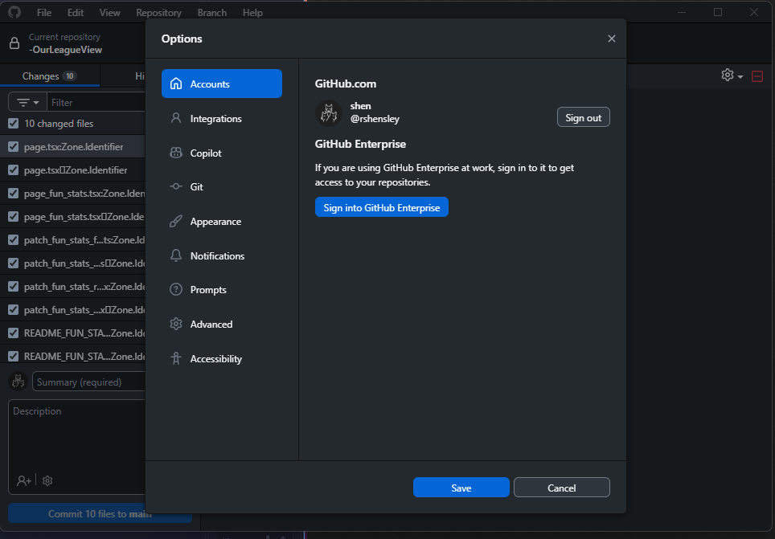
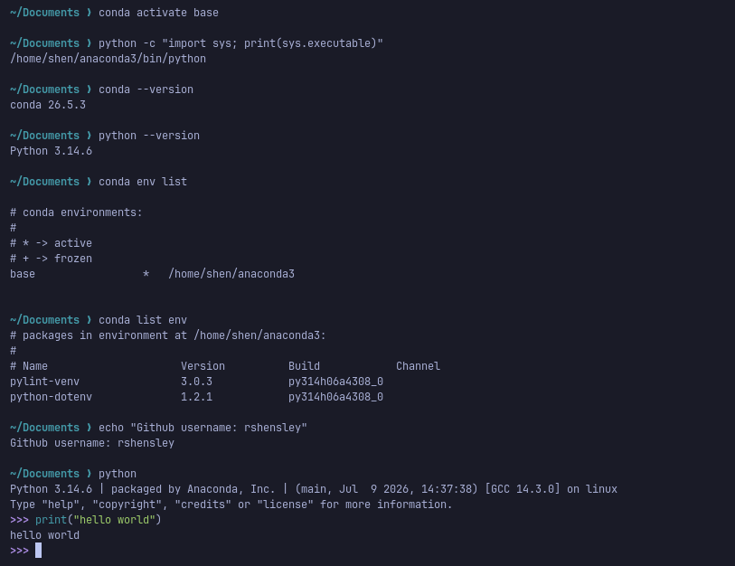
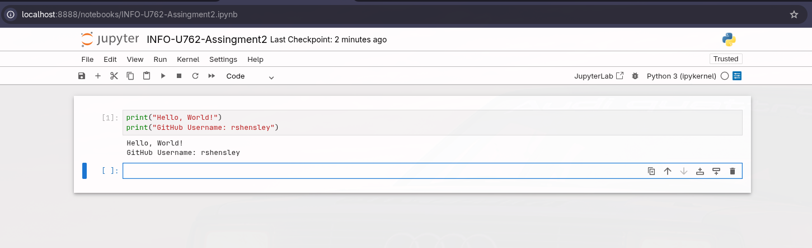
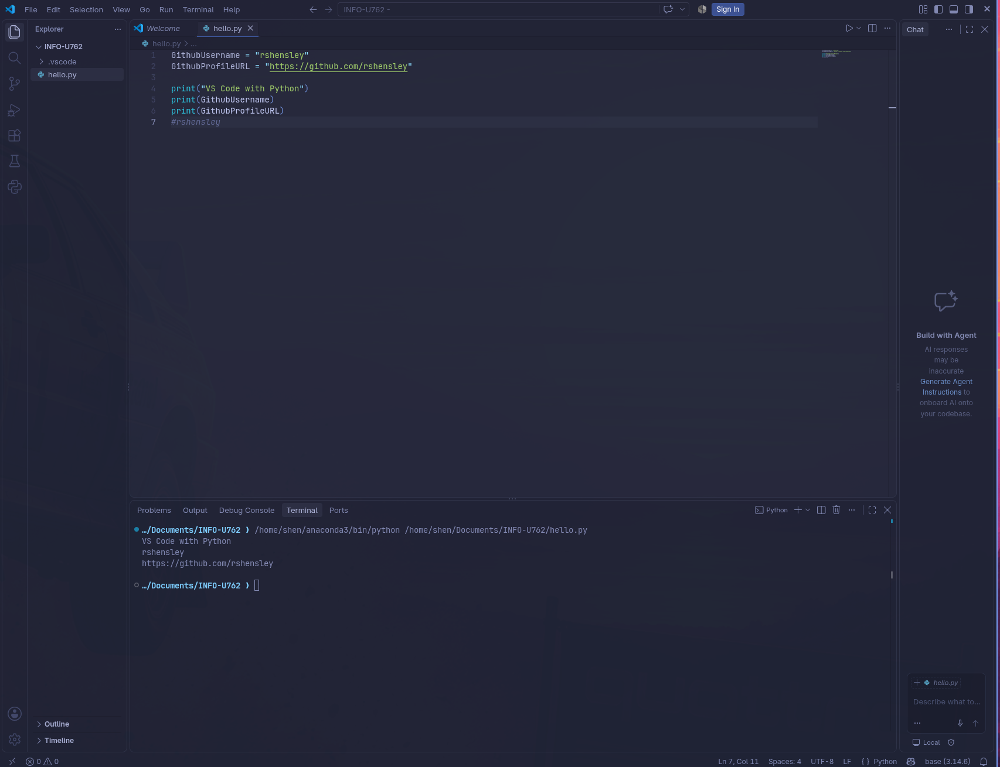

# INFO-U762 — Module 1 Assignment 2
## Python and GitHub Staging

**GitHub Username:** rshensley  
**GitHub Profile:** https://github.com/rshensley

**Course:** INFO-U762 — Interoperability

## 1. GitHub Desktop

GitHub Desktop is installed and configured on Windows.

## 2. Anaconda and Python

Anaconda Distribution is installed on Omarchy Linux.

- Conda Version: 26.5.3
- Python Version: 3.14.6

## 3. Jupyter Notebook

## 4. Visual Studio Code

Visual Studio Code is installed on Omarchy Linux and configured for Python development.

---

**Development Environments:** Omarchy Linux and Windows 11
